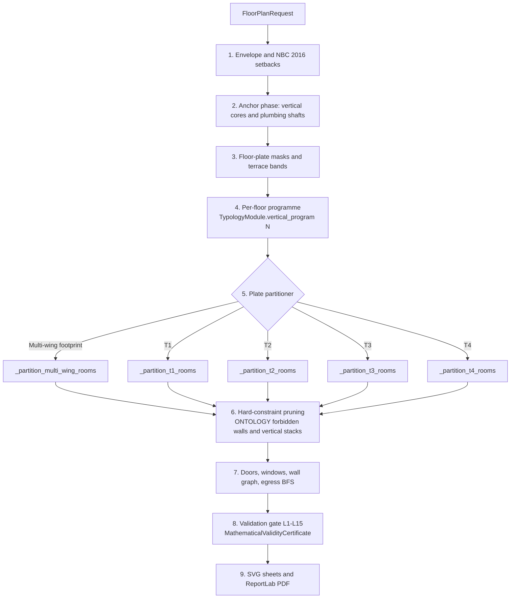

# Generative Blueprint Engine
> `Spatial CSP` • `Ontology Dispatch` • `Vastu Shastra` • `Topological Invariants` • `ReportLab Vector Drawing`

Architecture and mathematical specification of the BuildWise generative architectural floor plan engine (`app/services/floorplan/` and `app/placement/`). Covers the placement knowledge base, topological invariants, the envelope-first plate solver, ontology-driven typology dispatch, the QA gate, and vector PDF rendering.

---

## Table of Contents
- [Engine Pipeline](#engine-pipeline)
- [Architect Placement Knowledge Base](#architect-placement-knowledge-base)
- [Topological Invariants](#topological-invariants)
  - [1. Leaf Rule (Degree == 1)](#1-leaf-rule-degree--1)
  - [2. Peripheral Service Rule](#2-peripheral-service-rule)
  - [3. Central-Box Exclusion](#3-central-box-exclusion)
  - [4. Circulation Hub & Entry Axis](#4-circulation-hub--entry-axis)
  - [5. Forbidden Adjacency Matrix](#5-forbidden-adjacency-matrix)
- [Envelope-First Layout Solver](#envelope-first-layout-solver)
- [Typology Dispatch (Ontology-Driven)](#typology-dispatch-ontology-driven)
  - [Resolution](#resolution)
  - [The Four Dispatch Targets](#the-four-dispatch-targets)
  - [Dispatch Inside the Plate Partitioner](#dispatch-inside-the-plate-partitioner)
  - [Hard-Constraint Pruning](#hard-constraint-pruning)
  - [Module Contract and Sheet Gates](#module-contract-and-sheet-gates)
  - [Extending the Dispatch](#extending-the-dispatch)
- [Deterministic Validation Gate](#deterministic-validation-gate)
- [Vector Blueprint Rendering & PDF Integration](#vector-blueprint-rendering--pdf-integration)
- [Navigation](#navigation)

---

## Engine Pipeline

Floor plan generation is one deterministic pass: the envelope is fixed before any
room exists, the programme comes from the ontology, and the plate either clears
every hard relation or the solve reports why it could not.



---

## Architect Placement Knowledge Base

Defined in `app/placement/kb.py`.

The Knowledge Base codifies Indian residential architectural canon (National Building Code 2016 and Vastu Shastra) as strict typed data models (`RoomPlacementRule`):

| Room Type | Human Title | Preferred Zone | Allowed Bands | Required Adjacency | Forbidden Adjacency | Leaf Node? | Ext. Wall? | Min Area |
|:---|:---|:---|:---|:---|:---|:---:|:---:|:---:|
| **`living`** | Living Room | N, E, NE, Center | Front | Exterior, Corridor | *(None)* | **No** (Hub) | Yes | 18.0 m² |
| **`pooja`** | Pooja Room | NE (Ishanya) | Front, Flank | Living, Corridor | Bath, WC, Kitchen, Bed | **Yes** | Yes | 4.0 m² |
| **`kitchen`** | Kitchen | SE (Agneya) | Rear, Flank | Dining, Living, Corridor | Bath, WC, Pooja, Bed | **Yes** | Yes | 9.0 m² |
| **`master_bed`** | Master Bedroom | SW (Nairutya) | Rear, Flank | Corridor | Kitchen | **Yes** | Yes | 14.0 m² |
| **`bedroom`** | Bedroom | W, NW, S | Rear, Flank | Corridor | Kitchen | **Yes** | Yes | 10.0 m² |
| **`common_bath`**| Common Bath | NW, W | Flank, Rear | Corridor | Pooja, Kitchen, Entry Axis | **Yes** | Yes | 3.5 m² |
| **`attached_bath`**| Attached Bath | W, NW, S | Flank, Rear | Master Bed | Pooja, Kitchen | **Yes** | Yes | 3.5 m² |
| **`wc_utility`** | WC / Utility | NW, W | Flank, Rear | Corridor | Pooja, Kitchen | **Yes** | Yes | 1.5 m² |
| **`dining`** | Dining Area | E, Center | Middle, Front | Kitchen, Living, Corridor | Bath, WC | **No** | No | 8.0 m² |
| **`corridor`** | Corridor | Center | Middle | Living | *(None)* | **No** (Hub) | No | 6.0 m² |

---

## Topological Invariants

The Dissection Engine and Placement Validator enforce 5 non-negotiable architectural invariants:

### 1. Leaf Rule (Degree == 1)
In the circulation door graph, all sanitary spaces (baths, toilets, utilities) and sacred spaces (pooja) must be **leaf nodes**:
$$\text{degree}(v) = 1 \quad \forall v \in \{\text{common\_bath}, \text{attached\_bath}, \text{wc\_utility}, \text{pooja}\}$$
No service space can ever have multiple doors or permit through-traffic between bedrooms or living spaces.

### 2. Peripheral Service Rule
Every bathroom, WC, and kitchen must share at least one edge with the building's exterior envelope:
$$\text{edge}(v) \cap \partial(\text{Envelope}) \neq \emptyset \quad \forall v \in \{\text{service rooms}\}$$
This guarantees natural cross-ventilation, light shafts, and accessible plumbing risers without internal light wells.

### 3. Central-Box Exclusion
The central 40% box of the building envelope represents the core circulation spine (and the *Brahmasthan* under Vastu canon):
$$C_{\text{box}} = [x_{\text{min}} + 0.30W, x_{\text{min}} + 0.70W] \times [y_{\text{min}} + 0.30D, y_{\text{min}} + 0.70D]$$
No service room centroid may lie within this central 40% bounding box:
$$\text{Centroid}(v) \notin C_{\text{box}} \quad \forall v \in \{\text{common\_bath}, \text{wc\_utility}, \text{kitchen}\}$$

### 4. Circulation Hub & Entry Axis
- The **main entry door** must open exclusively into the **Living Room** (or dedicated front foyer).
- The living room serves as the circulation hub connecting to the central corridor spine.
- Under no circumstances may an entrance door open into a bathroom, kitchen, or private bedroom.

### 5. Forbidden Adjacency Matrix
To preserve sanitation and cultural canon, bathrooms/WCs and pooja rooms are strictly prohibited from sharing a wall:
- **Zero Shared Wall Length:** $\text{Wall}(\text{bath}) \cap \text{Wall}(\text{pooja}) = \emptyset$
- **Zero Shared Wall Length:** $\text{Wall}(\text{bath}) \cap \text{Wall}(\text{kitchen}) = \emptyset$

---

## Envelope-First Layout Solver

The plan is produced by `app/services/floorplan/engine.py`, the sole geometry
engine: it subtracts NBC 2016 setbacks from the plot boundary, fills the
resulting envelope with rectangular rooms, and rejects any layout that does not
tile it.

`tests/blueprint/test_floorplan.py::test_dissection_engine_contiguity_and_no_voids` pins
the tiling contract — 100% envelope coverage, no interior voids, and no
overlapping room rectangles. `csp_engine.py` holds the earlier backtracking
constraint solver; it is retained for the single-floor regression tests and is
not on the engine's path.


---

## Typology Dispatch (Ontology-Driven)

`SoleGeometryEngine` (`app/services/floorplan/engine.py`) is the single geometry
path for every typology and every storey count. It stores no plates: the request
resolves to one of four canonical typologies and one partitioning loop runs over
ontology data. Templates A/B/C, the guillotine fallback and the low-strictness
canonical template are gone — a plate either satisfies the ontology's hard
relations or the solve fails with an explicit reason.

### Resolution

`__init__` resolves `request.building_typology` through `ONTOLOGY.get_typology(...)`
and keeps `profile.canonical`. Free-text values (`apartment`, `duplex`,
`commercial`, `office`, `warehouse`, …) normalize inside the `TypologyProfile`
matching in `app/services/floorplan/ontology.py`; anything unrecognised —
including bare `residential` — resolves to `T1_SINGLE_FAMILY`.

The canonical key then selects exactly three inputs:

| Input | Consumed by | Source |
|:---|:---|:---|
| Per-level programme | `_resolve_floor_program` | `get_typology_module(self.typology).vertical_program(N)` |
| Storey height, egress travel limit, parking ratio | `_lock_vertical_anchors`, `_verify_egress_and_circulation`, `_compute_statutory_compliance`, wall graph | `TypologyProfile.floor_height_m`, `.egress_constants`, `.parking_table` |
| Plate topology | `_partition_floor_plate` | `_partition_t1_rooms` … `_partition_t4_rooms` |

Everything else — minimum areas and widths, hygiene classes, Vastu zone weights,
forbidden adjacencies, vertical stacking bans — is read from the `SpaceTypeSpec`
records in the same ontology. Switching typology changes the programme and the
partitioner, not the rule set.

### The Four Dispatch Targets

All four modules implement `TypologyModuleProtocol`
(`app/services/floorplan/typologies/protocol.py`) and answer `vertical_program(N)`
with the space ids each level is programmed for. The partitioners emit their leaf geometry;
aggregate ids such as `apt_unit_1`, `open_office` and `racked_storage` are programme
concepts and never become rooms.

| Typology | Programme per level | Depth | Partitioner |
|:---|:---|:---:|:---|
| **T1** `T1_SINGLE_FAMILY`<br>`T1ResidenceModule` | G — `foyer · living · dining · kitchen · utility · puja · bath_1` (a single-storey request adds `master_bed`); G+1 — `central_lobby · master_bed · bed_2 · bath_master · bath_2 · balcony · study`; G+2 — `master_bed · bed_2 · bath_master · bath_2 · balcony` | 1–3 | `_partition_t1_rooms` |
| **T2** `T2_FAMILY_APARTMENT`<br>`T2ApartmentModule` | G — `floor_lobby · apt_unit_1 · apt_unit_2 · guard_house`; G+1 and above — `floor_lobby · apt_unit_1 · apt_unit_2`, emitted as `t2_unitA_*` / `t2_unitB_*` leaves | 1–4 | `_partition_t2_rooms` |
| **T3** `T3_LARGE_COMPLEX`<br>`T3ComplexModule` | G — `reception · visitor_lounge · conference_room · sanitary_block · server_room · electrical_room`; upper — `spine_corridor · open_office · private_office · meeting_room · sanitary_block · pantry`, emitted as `t3_suite_*` leaves | 1–4 | `_partition_t3_rooms` |
| **T4** `T4_WAREHOUSE`<br>`T4WarehouseModule` | G — `dock_bay · dispatch · heavy_bay · racked_storage · worker_amenity · guard_house`; mezzanine (+3.60 m) — `admin_catwalk · admin_office · conf_room` | 1–2 | `_partition_t4_rooms` |

`Depth` is the clamp inside each module's `vertical_program`; the engine itself
bounds a request to 1–4 storeys, and any level past the table reuses the last
programme entry.

### Dispatch Inside the Plate Partitioner

`_partition_floor_plate` takes the first matching branch, in this order:

1. **Multi-wing footprint** — when `site_plan.footprint.wings` holds more than one
   wing (L-shape or courtyard plot), `_partition_multi_wing_rooms` builds the
   wing-by-wing plate and the typology partitioner is skipped.
2. **Single-storey T1 with a client programme** — a one-storey T1 request carrying
   at least three `required_rooms` goes straight to `_partition_t1_rooms`, whose
   4- to 8-room arrangements key on the requested room names.
3. **Default** — the vertical core and its lobby spine are locked first (the name
   follows the typology: Entrance Foyer, Central Distribution Lobby, Double-Loaded
   Spine Corridor, Mezzanine Access Catwalk), then `self.typology` selects
   `_partition_t{1..4}_rooms` for the remaining plate.

### Hard-Constraint Pruning

Every branch ends in `_prune_and_verify_hard_constraints`, which rejects room
overlap, shared walls that `ONTOLOGY.is_forbidden_wall` bans
(HYG-01 foul against sacred, HYG-02 foul against food), `FloorLoad.HEAVY` on any
upper level (VERT-04), and wet-over-habitable stacking through
`ONTOLOGY.evaluate_vertical_stack` (VERT-02). These raise; there is no retry with a
different template. An envelope that cannot hold the programme returns a failed
`MultiStoreyBuildingModel` with `unmet_requirements` instead of a canned plan.

### Module Contract and Sheet Gates

| Member | Returns | Read by |
|:---|:---|:---|
| `catalog()` | `SpaceTypeSpec` map resolved from `ONTOLOGY` | tests; the engine queries the ontology directly |
| `vertical_program(N)` | per-level `space_ids` and label | `_resolve_floor_program`, unmet-requirements ledger |
| `layout_strategy()` | zoning bands, T2 50/50 unit split, T3 1.50 m corridor, T4 6 m bays, 3.60 m apron and +3.60 m mezzanine | tests — the partitioners realise those bands as fixed constants today |
| `sheet_gates()` | optional drawing layers: Vastu diagram (T1, T2), unit schedule (T2, T3), column grid with dock apron and mezzanine section (T4); egress and dimension chains always on | tests |
| `compose_sheet(level_plan, theme)` | SVG through the shared drawing IR | tests; the engine's sheet loop calls `generate_multi_floor_blueprint_svg` directly so each sheet can carry the L1–L15 gate table |

### Extending the Dispatch

A new room type is a data change: add a `SpaceTypeSpec` to `UNIVERSAL_SPACE_CATALOG`
(50 entries today) and list its id in the typology module's `_GROUND_IDS` or
`_UPPER_IDS`. Its relations to every other space follow from its attributes through
`derive_spatial_rules` — hygiene, emissions, security and floor load generate the
rule ids, so a new cleanroom inherits the foul-vs-sacred wall ban and the
wet-over-habitable stacking ban without touching the engine.
`tests/blueprint/test_ontology_contracts.py::test_zero_solver_change_extensibility` pins that contract.

---

## Constrained Placement Solver & Ranked Schemes

Defined in `app/services/floorplan/constrained_solver.py` and
`app/services/floorplan/scheme_solver.py`. This is an **additive** path: the
legacy single-plan response is unchanged unless the caller sets
`include_scheme_alternatives`.

### Geometry rule

On a rectangular buildable envelope the solver places a stacked west core
column, an entry lobby, a single front/rear spine, and two programme bands.
It enumerates front/rear assignments for `MUST_ADJACENT` blocks, then scans for
the shallowest band depth that satisfies every floor's minimum area, minimum
width and band capacity. Core coordinates are identical on every storey. The
rear band consumes the remaining depth; a deep single-loaded plate consumes it
with programme rather than letting the corridor swallow it.

Multi-wing and terrace-band plates are **not** re-partitioned here: the solver
returns the validated RULE-FP geometry with an explicit fallback provenance tag.

Hard checks use the exact normalizer (`resolve_space_id`), never
substring matching: forbidden wall pairs, egress connectivity, minimum
area/width, required-room presence. Aspect ratio is a soft, scored advisory in
the scheme solver because a full-band-depth room cannot satisfy a narrow-room aspect
without a dimensional trade.

### Scoring profiles

| Profile | Area | Vastu | Light/Vent | Relations | Compactness |
|:--|--:|--:|--:|--:|--:|
| `max_area` | 0.40 | 0.05 | 0.10 | 0.15 | 0.30 |
| `max_vastu` | 0.15 | 0.50 | 0.05 | 0.20 | 0.10 |
| `max_light_vent` | 0.15 | 0.10 | 0.45 | 0.20 | 0.10 |

Each scheme carries land-use efficiency, circulation ratio, Vastu, daylight,
relation satisfaction, compactness, total score, hard-violation counts, egress,
minimum-dimension violations, furniture fit, programme deficit, dropped rooms,
deltas vs the legacy engine and vs the best scheme, and full floor geometry
(rooms, doors, windows, wall graph, SVG). Ranking is feasible-first, then score
descending, then stable scheme id. The user's selection is recorded in
`SchemePortfolio.selection_source`.

### Programme compression

If a programme cannot fit, optional rooms are dropped **one at a time** from the
lowest-importance end, each with an explicit warning and a recorded deficit.
Essential rooms (the T1/T2 unit core, T3 reception/sanitary/office suites, T4
loading/dispatch/storage/amenity) are never dropped. An infeasible scheme keeps
its warnings and is ranked below feasible schemes; it is never silently squeezed.

---

## Land Economics & Residual Absorption

Defined in `app/schemas/land_economics.py` and
`app/services/floorplan/land_economics.py`. Every response carries a
`LandEconomicsReport`; the programme-sized envelope is opt-in through
`program_aware_footprint`, so default rectangular geometry and the scheme alternatives path
remain unchanged.

### Programme demand

`compute_program_needed_area` runs **before** geometry. It expands each storey's
programme through the ontology catalogue and sums minimum carpet areas, a 14 %
circulation allowance (floor 8 m²), an 8 % wall allowance and the stacked core
(plus lift/second stair where the typology requires them). The largest storey
wins, floored at 30 m². The footprint is therefore never sized by its own rooms.

When `program_aware_footprint` is set on a rectangular plot:

```
target = min(available setback envelope, plot × coverage, programme need)
```

The plate keeps the available envelope aspect and is centred in the buildable
area. `footprint_source` records the binding constraint: `program`, `coverage` or
`inscribed` (irregular plots). A demand above the cap raises `LAND-01`;
`LAND-04` says the flag is off, and `LAND-06` says an irregular inscribed plate
cannot be shrunk by the programme.

### Residual law

`compute_land_economics` treats the site as three pairwise disjoint surfaces:
footprint, labelled wedges and outdoor fragments. Ring-shaped setback yards are
split into four full-width/full-height bands so the corner squares are not lost.
Any unlabelled residual ≥ 1.0 m² is absorbed as a labelled wedge; anything below
that is reported as anonymous area, never silently dropped. The site SVG and
`site_plan.waste_pct` are refreshed after absorption.

`repair_interior_dead_corners` closes rectangular gaps inside the wing/courtyard
plate immediately after partitioning. It first offers the gap to an adjacent
room, but only when the full extension respects that room's certificate aspect
tolerance. Otherwise the gap becomes a `Dead-Corner Storage` service room with a
hosted door, keeping BFS and the mathematical certificate valid. Repair runs on
the ground plate; upper-floor masks and terrace bands are untouched.

### SPACE-EFFICIENCY certificate

`LandEconomicsReport` mirrors into `multi_storey.land_economics` and the
`global_metrics` / `qa_report` summaries. It reports programme demand and deficit,
buildable/coverage/footprint areas, footprint source, ground programme and
circulation, total GFA, land-use efficiency (`eff_g`), footprint utilisation, FAR,
circulation ratio, wedge/outdoor/occupied/waste areas, anonymous outdoor area,
ground dead-corner area, residual slivers, absorbed count and furniture fit.

Hard checks: footprint containment, coverage, programme fit. Advisory checks:
circulation 12–20 %, footprint utilisation ≥ 90 %, zero anonymous outdoor area,
all residuals labelled, zero interior dead corners ≥ 1 m², furniture fit ≥ 80 %.
A hard failure gives `FAIL`; any advisory gives `WARN`. This certificate is
**separate** from the L1–L15 gate so sheets and PDF consumers keep their contract.

### Measured effect

The sweep matrix (32 cases) moves from 8 waste cases / 16 slivers to **zero waste
and zero slivers**, with minima (196) and mean `eff_g` (67.0 %) unchanged. The
opt-in programme plate also reaches zero waste/slivers but exposed the legacy
partitioner's furniture gap (minima 204, furniture pass < 80 % in 17 cases, mean
`eff_g` 65.3 %); furniture placement closes that gap at solve time.

---

## Ontology Space Identity

Every placed room now carries one resolved `SpaceIdentity` (schema in
`app/schemas/space_identity.py`; resolver in `app/services/floorplan/identity.py`).
The object owns the final display name, canonical zone, function/hygiene class,
clear-area basis, statutory minima, citations, orientation and ``is_wet``. Room
rows keep denormalized ``room_name`` / ``zone_category`` for backward
compatibility, but labels, schedules, legends and service layers read identity.

The pass runs after L5 naming honesty and before openings, furniture, wall graphs
and the gate. A 12 m² "Master Suite" is demoted first and receives a
``master_bed`` identity; a certified 15 m² suite receives ``master_suite``.
Unresolved ids produce an explicit ``unresolved:<id>`` fallback with a warning
and a coverage count, never a silent guess.

Downstream contracts: ``ClearRoom`` and room-schedule rows carry
``space_type_id`` / ``identity`` / ``is_wet`` / ``is_sanitary``; sanitary
partitions and sanitary windows use the ontology hygiene class, not every wet
point; SVG labels and PDF legend use the identity name; the
terrace drainage layer keys off the identity space type. The PDF legend no
longer skips a room just because its display name already appeared: every room
gets a numbered row (the legend still caps at 12 rows per floor). Repeated names
are kept rather than deduped; 119 occur across the 32-case matrix.

Identity coverage is 100 % on all 32 sweep cases with zero fallbacks. Geometry
and gate parity were otherwise unchanged (0 waste, 0 slivers, 196
minima, mean ``eff_g`` 67.0 %, 4 FAIL / 28 WARN).

---

## Furniture and Fresh Air at Solve Time

New modules: `app/services/floorplan/furniture.py` and
`app/services/floorplan/ventilation.py`.

Furniture is no longer a post-solve nominal check. Every ontology item is placed
as a rectangle inside the room, using orientation-aware layouts for beds, living,
dining and kitchens and a wall-run packer for office, meeting, locker, server and
other sets. `place_and_audit_furniture_catalog` requires the complete set to be
placed and disjoint; a partially placed set is a failure.

Before openings are hosted, `repair_room_envelopes_for_furniture` rebalances
frontage inside each band so the actual room width can hold its set. It first
preserves statutory width and area floors; when a row is already over-programmed
(the trapezoid's 6.0 m wing), it prioritises furniture plus width floors and
reports the statutory shortfall explicitly. The production partitioner and
`constrained_solver._local_bands` call the same repair, so the legacy and scheme
paths cannot drift.

After openings and identity are known, `ensure_wet_room_ventilation` gives every
wet room without a compliant opening or existing shaft a dedicated 0.45 m
exhaust riser with the room id in `servicing_rooms`. The riser is in
`multi_storey.duct_shafts` before the wall graph and sheets are built. L9 uses
the identity `is_wet` flag rather than zone/substring heuristics.

Measured on the 32-case sweep matrix:

| Metric | Default | Programme-aware |
|:--|--:|--:|
| Cases with furniture pass < 80 % | **0** (was 14) | **0** (was 16) |
| Furniture-pass distribution | **100 % on all cases** | **100 % on all cases** |
| Cases with L9 mechanical warning | **0** (was 18) | **0** (was 17) |
| Rooms below ontology minima | **196** | **202** (was 204) |
| Mean `eff_g` | **68.39 %** | **66.79 %** (was 65.35 %) |
| Waste > 0.1 m² / slivers | **0 / 0** | **0 / 0** |
| Gate result | **4 FAIL / 16 WARN / 12 PASS** | **4 FAIL / 16 WARN / 12 PASS** |
| Determinism | **4/4, 0 mismatches** | **4/4, 0 mismatches** |

---

## Typology Programme and Building Intent

New module: `app/services/floorplan/room_aliases.py`; new frontend module
`src/services/typologyProgramme.ts`.

Legacy programme IDs (`apt_a_living`, `loading_dock`, `staircase_core`) used to
reach a solver that only understands ontology IDs. The plan was solved
correctly and then reported "requirement not met" rows. `FloorPlanRequest` now
normalizes `required_rooms` through the alias table: canonical IDs pass through,
known aliases resolve, unknown IDs are preserved so a real mismatch is still
reported, and unit-scoped duplicates collapse in request order. The frontend
catalogue is pinned to the backend catalogue by a test that parses it.

T2 now emits the programme its catalogue declares: a bathroom, living/dining,
kitchen and bedroom in **every unit on every floor**, with the living against
the shared lobby. The kitchen slot is sized against the band depth, and the
frontage repair treats proportion as soft: statutory width/area floors and the
furniture set are hard, and aspect-ratio width is bought only from genuine spare
frontage (widening capped at 1.5x, with an explicit warning when a band cannot
be re-sliced into proportion).

The vertical law is class-scoped: a wet room over the *same* wet class
(kitchen over kitchen, bath over bath) is the preferred single-stack condition
(`VERT-01-WET-STACK-ALIGN`, `MUST_STACK`), while foul drainage over a different
class (bath over kitchen) remains `VERT-02` forbidden. `VERT-05` mezzanine fire
separation and `VERT-06` no-wet-over-terrace complete the set.

Drawings print the unit chip only on the unit entry door and anchor it at the
corner of the unit's own room, scored against on-plan text, opening tags and
stair labels; the vector PDF uses the same anchor. The viewer states what was
generated (`Generated as` strip with typology, storeys, GFA, unit count and
identity-based programme counts, plus a request-vs-sheet mismatch chip) and
opens a room inspector with identity, clear area, openings, shafts and
furniture.

Measured on the 32-case sweep matrix (default / programme-aware):

| Metric | Before | After |
|:--|--:|--:|
| Mean `eff_g` | 68.39 % / 66.79 % | **68.33 % / 66.73 %** |
| Max `eff_g` | 84.7 % | **86.6 %** (T2 rect) |
| Rooms below ontology minima | 196 / 202 | **192 / 198** |
| Cases with furniture pass < 80 % | 0 / 0 | **0 / 0** |
| Gate result | 4 FAIL / 16 WARN / 12 PASS | **4 FAIL / 18 WARN / 10 PASS** |
| Determinism | 4/4 | **4/4, 0 mismatches** |

The two PASS-to-WARN cases are compact T2 plates that now emit kitchens on a
plate too small for two full units; the shortfall is reported rather than
suppressed.

---

## Deterministic Validation Gate

Defined in `app/services/floorplan/validation_gate.py`.

Every generation — any typology, any floor count — is judged by the same L1–L15
layer stack: geometry and statutory invariants, door swings, fixture and furniture
clearances, naming honesty, stairs, Vastu scoring, program intent, ventilation, wet
cores and plumbing, terrace drainage, structure, accessibility, fire/egress, and
programme completeness (every unit/building has its essential rooms). No
layer is skipped: one that does not apply is recorded as N/A with an explicit
reason, and N/A never makes a plan invalid on its own. The overall status is the
worst **evaluated** layer (FAIL > WARN > PASS); N/A is a skipped layer, not a
quality status.


---

## Vector Blueprint Rendering & PDF Integration

The blueprint engine generates two presentation formats:

### 1. Interactive Web SVG (`app/services/floorplan/svg_generator.py`)
- Scalable vector graphics rendered dynamically in `BlueprintViewer.tsx`.
- Architectural hatching, swing door arcs, dimension ticks, room labels, area callouts, and North arrow orientation.

### 2. High-Resolution PDF Vector Drawing (`app/services/report_service.py`)
- Generated via `draw_floorplan_reportlab()`.
- Renders directly onto a dedicated page in the formal engineering report using ReportLab vector primitives (`Rect`, `Line`, `ArcPath`, `String`).
- Scaled to the full page content width (174mm) accompanied by a 4-tile solver metric strip and color-coded room legend.

---

## Navigation
- **Previous:** [← AI Pipeline & Adapters](ai-pipeline.md)
- **Next:** [Space Engine →](space-engine.md)

---
*BuildWise AI • [MIT License](../LICENSE) • Copyright (c) 2026 Rolan Lobo*
